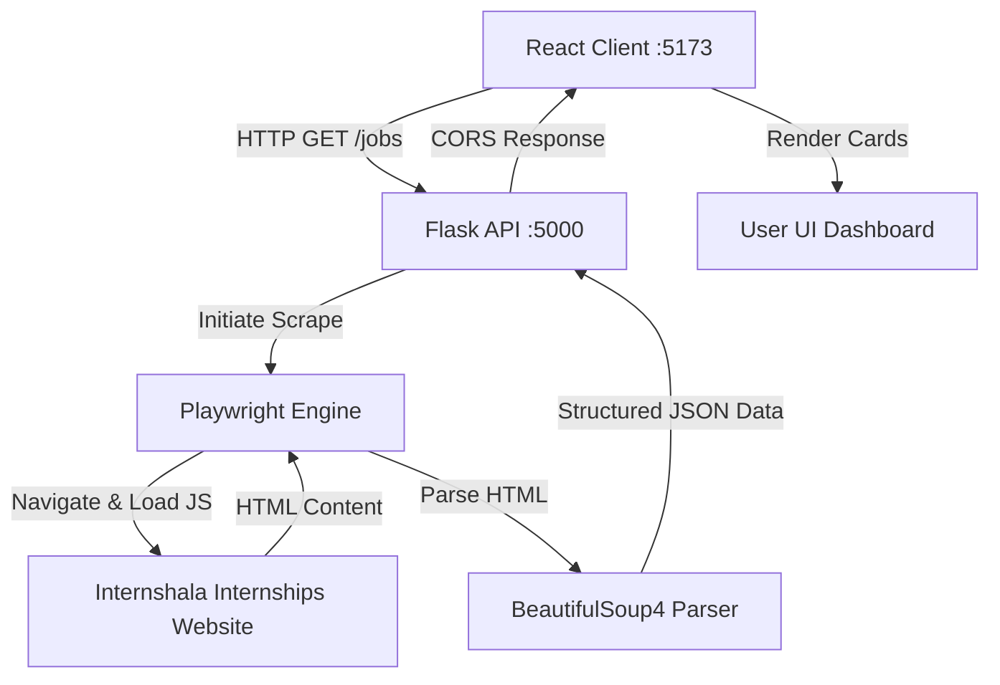

# 💼 Velai-Vaaippu (JobMaxxing)

[](https://react.dev/)
[](https://vite.dev/)
[](https://flask.palletsprojects.com/)
[](https://playwright.dev/)
[](https://www.crummy.com/software/BeautifulSoup/)

**Velai-Vaaippu** (translates to *Job Opportunity* in Tamil), also referred to as **JobMaxxing**, is a modern full-stack web application designed to simplify the internship search process. It automatically scrapes, aggregates, and presents real-time internship postings from Internshala directly to the user in a clean, unified dashboard.

---

## 🏗️ Architecture Flow

The application leverages a decoupled microservices-like architecture:
1. **Frontend**: A React application built with Vite that fetches aggregated data.
2. **Backend**: A Flask web api service serving endpoints.
3. **Scraper Engine**: A web scraper powered by Playwright and BeautifulSoup4 that dynamically navigates, waits for client-side JavaScript rendering, and extracts details.



---

## ✨ Features

- **Dynamic Headless Scraping**: Launches a headless Chromium browser using Playwright to bypass initial static load limitations and execute client-side scripts.
- **Rich Data Extraction**: Extracts comprehensive listings, including:
  - **Job Title & Company Name**
  - **Location** (On-site / Work from Home)
  - **Stipend Details** and **Duration**
  - **Required Skills** (rendered as clean tag components)
  - **Application Status & Deadlines**
  - **Pre-Placement Offer (PPO)** opportunities
- **Decoupled API Routing**: Utilizes Flask Blueprints for routing and clean codebase division.
- **Modern Component-driven UI**: Features a card-based React UI layout designed for quick scanning and ease of reading.

---

## 🛠️ Tech Stack

### Frontend
- **Framework**: React 19
- **Bundler / Build Tool**: Vite 7
- **Routing**: React Router DOM 7
- **Styling**: Component-level Tailwind CSS classes

### Backend
- **Core Framework**: Python 3 & Flask
- **Middleware**: Flask-CORS (Cross-Origin Resource Sharing enablement)
- **Scraping**: Playwright Python (`sync_api`)
- **Parsing**: BeautifulSoup4 (`bs4`)

---

## 🚀 Getting Started

Follow these instructions to set up the project locally on your machine.

### Prerequisites
- Python 3.9+
- Node.js 18+
- npm (Node Package Manager)

---

### 1. Backend Setup (Flask)

Navigate to the `api` directory and configure the environment:

```bash
# Navigate to api folder
cd api

# Create a virtual environment
python -m venv venv

# Activate the virtual environment
# On Windows (PowerShell):
.\venv\Scripts\Activate.ps1
# On Windows (CMD):
.\venv\Scripts\activate.bat
# On macOS/Linux:
source venv/bin/activate

# Install the required Python packages
pip install -r requirements.txt

# Install Playwright browsers (Required for headful/headless automation)
playwright install chromium
```

To run the Flask server:
```bash
python api.py
```
The API server will launch at `http://127.0.0.1:5000`.

---

### 2. Frontend Setup (React + Vite)

In a new terminal, navigate to the `client` directory and install dependencies:

```bash
# Navigate to client folder
cd client

# Install packages
npm install
```

To launch the frontend development server:
```bash
npm run dev
```
The client application will run at `http://localhost:5173`. Open this URL in your web browser.

---

## 📈 Future Enhancements
- **Caching & Database Storage**: Implement a MongoDB or PostgreSQL database to cache job postings, avoiding high scraping latency on every page refresh.
- **Search & Advanced Filtering**: Add filter controls for stipend amount, duration, remote/on-site status, and required skills.
- **Scheduled Cron Jobs**: Configure celery/cron tasks to scrape listings periodically in the background rather than on-demand.
- **Job Tracker & Application History**: Let users save jobs, write notes, and track their application progress.
