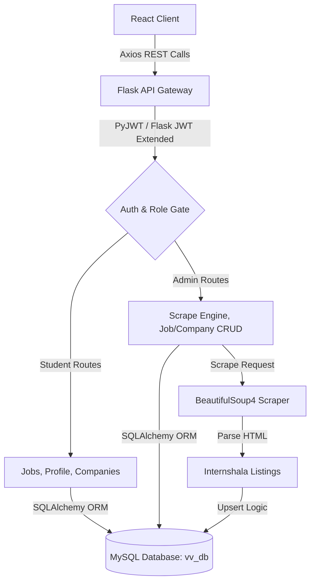

# 💼 Velai-Vaaippu (JobMaxxing) — Advanced Branch

[](https://react.dev/)
[](https://vite.dev/)
[](https://flask.palletsprojects.com/)
[](https://www.sqlalchemy.org/)
[](https://www.mysql.com/)
[](https://jwt.io/)
[](https://www.crummy.com/software/BeautifulSoup/)

Welcome to the **`jithu`** branch of **JobMaxxing** . This branch upgrades the codebase from a simple scraping tool to a **secure, database-backed enterprise aggregator platform** with user authentication, profile management, and role-based permissions.

---

## 🏗️ Architecture & Database Flow

The platform utilizes a structured relational database model to organize companies, scrape sources, and job cards. 



### 🗄️ Database Schema
The database (managed via `Flask-Migrate` / `Alembic`) contains four key models defined in [api/models.py](file:///d:/Projects/jithu/JobMaxxing/api/models.py):

*   **`User`**: Manages credentials, hashed passwords (using Werkzeug security), roles (`student` vs. `admin`), and student resume URLs.
*   **`Company`**: Standardized company catalog.
*   **`JobSource`**: Maps the platform source type (e.g. `internshala`) and url metadata.
*   **`Job`**: Details including title, location, salary/stipend, duration, apply link, deadline, active status, and timestamps.

---

## ✨ Features Added in this Branch

1.  **User Authentication & Security**:
    *   Secure signup (`POST /users`) and login (`POST /login`) with Werkzeug password hashing.
    *   **JWT Token Verification** (with 2-hour expiration) guarding routes and sessions.
2.  **Role-Based Access Control**:
    *   **Students**: View job listings, inspect job details, manage accounts, and upload resume links.
    *   **Admins**: Trigger automated scrapers (`/admin/scraping`) and run full CRUD operations (Edit/Delete) on jobs and companies.
3.  **Relational Database Persistence**:
    *   Replaced inline list-dumps with **MySQL database storage**.
    *   Smart upsert routines mapping scraped listings to existing Companies and JobSources without duplicates.
4.  **Polish Custom CSS Design System**:
    *   A centralized stylesheet design system in [client/src/styles/](file:///d:/Projects/jithu/JobMaxxing/client/src/styles/) containing styling for login forms, profile views, header layouts, message boxes, and dashboard cards.

---

## 🛠️ API Reference

### Auth Endpoints
*   `POST /users` — Sign up a new user (default role: `student`).
*   `POST /login` — Authenticate and receive a JWT Bearer token.
*   `GET /user/role` — Verify JWT validity and fetch user authorization level.

### Job Endpoints
*   `GET /jobs` — Retrieve active jobs from the database.
*   `GET /jobs/<job_id>` — Fetch detailed view for a single job description.
*   `PUT /jobs/<job_id>` — *(Admin only)* Edit job details.
*   `DELETE /jobs/<job_id>` — *(Admin only)* Delete job listing.

### Company Endpoints
*   `GET /companies` — List all registered companies.
*   `POST /companies` — *(Admin only)* Add a new company name.
*   `PUT /companies/<company_id>` — *(Admin only)* Edit company details.
*   `DELETE /companies/<company_id>` — *(Admin only)* Delete company.

### Scrape Endpoints
*   `GET/POST /scrape/python` — *(Admin only)* Scrape 5 pages of Python jobs.
*   `GET/POST /scrape/webdev` — *(Admin only)* Scrape 5 pages of Web Development jobs.
*   `GET/POST /scrape/internships` — *(Admin only)* Scrape general internships.

---

## 🚀 Setting Up the Branch

### Prerequisites
*   **MySQL Server** running locally or remotely.
*   **Python 3.9+** and **Node.js 18+**.

### 1. Database Configuration
1. Log into your MySQL CLI or manager and create a database:
   ```sql
   CREATE DATABASE vv_db;
   ```
2. Create a `.env` file in the [api/](file:///d:/Projects/jithu/JobMaxxing/api/) directory (or configure the connection directly in [api/api.py](file:///d:/Projects/jithu/JobMaxxing/api/api.py)):
   ```env
   DATABASE_URL=mysql+mysqlconnector://<db_user>:<db_password>@localhost/vv_db
   ```
3. Initialize the database and run migrations:
   ```bash
   cd api
   flask db init
   flask db migrate -m "Initial migration"
   flask db upgrade
   ```

### 2. Backend Server Setup
In the [api/](file:///d:/Projects/jithu/JobMaxxing/api/) folder, run:
```bash
# Set up environment and dependencies
python -m venv venv
# On Windows (PowerShell/CMD):
.\venv\Scripts\activate
# On Linux/macOS:
source venv/bin/activate

pip install -r requirements.txt
python api.py
```
*API server spins up at `http://localhost:5000`.*

### 3. Frontend Client Setup
In the [client/](file:///d:/Projects/jithu/JobMaxxing/client/) folder, run:
```bash
npm install
npm run dev
```
*React client launches at `http://localhost:5173`.*

---

## 📂 Key File Directories

```
JobMaxxing/
│
├── api/                             # Python Flask Backend
│   ├── routes/                      # Route Blueprints (auth, jobs, scrape, profile, companies)
│   ├── scraping/                    # Scraping module (BeautifulSoup parser)
│   ├── models.py                    # SQLAlchemy Models
│   ├── api.py                       # App Entry Point & Database Configs
│   └── requirements.txt             # Backend Dependencies
│
└── client/                          # React Frontend
    ├── src/
    │   ├── api/                     # Axios API endpoints
    │   ├── components/              # Shared Elements (Header, JobCard, MessageBox, AdminRoute)
    │   ├── pages/                   # Views (Home, Jobs, JobPage, Profile, LoginPage, SignUpPage, ScrapePage)
    │   └── styles/                  # Clean CSS Design System
    └── package.json
```
